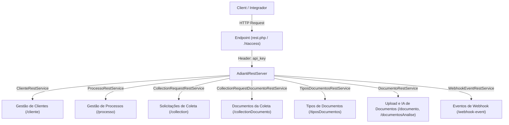

# 📚 Documentação da API REST - Captura de Documentos

Bem-vindo à documentação oficial da **API REST de Captura de Documentos**. Esta documentação foi elaborada para orientar desenvolvedores e integradores a consumir nossas rotas de maneira simples, rápida e segura.

---

## 🗺️ Visão Geral da Arquitetura

A API é construída sobre o framework Adianti e fornece serviços para gestão de clientes, processos de titulares, criação e acompanhamento de solicitações de coleta de documentos, análise de documentos com IA e histórico de Webhooks.



---

## 🚀 Endpoints Base & Estrutura de Chamadas

A API suporta rotas amigáveis configuradas via `.htaccess` que redirecionam para `rest.php`:

- **URL Base (Rotas Amigáveis)**:
  `http://localhost:8080/cliente` ou `https://seu-dominio.com.br/processo`
- **URL Direta (Framework)**:
  `https://seu-dominio.com.br/rest.php?class=ClienteRestService&method=handle`

---

## 🔑 Autenticação

As rotas da API são protegidas por autenticação em duas camadas:

1. **Autenticação de Gateway (rest.php)**:
   - `Authorization: Basic <REST_KEY>` (Chave REST da aplicação) ou `Authorization: Bearer <JWT_TOKEN>` (gerado em `/auth/{login}/{password}`).
2. **Autenticação de Domínio (api_key)**:
   - `api_key: SUA_CHAVE_API_AQUI` enviada no cabeçalho HTTP, identificando o cliente e isolando seus registros.

### Cabeçalhos Padrão da Requisição

```http
Authorization: Basic cmVzdF9rZXk6
api_key: SUA_CHAVE_API_AQUI
Content-Type: application/json
```

---

## 📦 Formato das Respostas (JSON)

Todas as respostas são retornadas em formato `application/json; charset=utf-8`.

### Resposta de Sucesso Padrão

```json
{
  "status": "success",
  "data": {
    "message": "Operação realizada com sucesso"
  }
}
```

### Resposta de Erro Padrão

```json
{
  "status": "error",
  "data": "Descrição detalhada do erro ocorrido"
}
```

---

## 📊 Códigos de Status HTTP

| Código | Descrição | Significado na API |
| :--- | :--- | :--- |
| `200 OK` | Sucesso | A requisição foi processada e os dados retornados com sucesso. |
| `201 Created` | Criado | Um recurso (Cliente, Processo, Coleta ou Documento) foi criado com sucesso. |
| `400 Bad Request` | Requisição Inválida | Parâmetros obrigatórios ausentes ou validação falhou (ex: CPF duplicado). |
| `401 Unauthorized` | Não Autorizado | Falha de autenticação geral no gateway REST. |
| `403 Forbidden` | Proibido | `api_key` inválida ou não fornecida. |
| `404 Not Found` | Não Encontrado | O recurso solicitado não foi localizado. |
| `422 Unprocessable` | Entidade Improcessável | Validação de negócio (ex: tipo de documento inválido ou documento reprovado na IA). |
| `500 Internal Error` | Erro Interno | Erro inesperado ao processar a solicitação no servidor. |

---

## 📁 Serviços Disponíveis

Acesse a documentação detalhada de cada serviço individual nos links abaixo:

1. 🏢 **[ClienteRestService](file:///Users/edutronicos/Projetos/capturaDocumentos/Documentacao/Cliente.md)** (`/cliente`)
   Cadastro de clientes parceiros, obtenção da `api_key` e atualização cadastral/webhook.
2. 👤 **[ProcessoRestService](file:///Users/edutronicos/Projetos/capturaDocumentos/Documentacao/Processo.md)** (`/processo`)
   Criação de processos de titulares, definição de documentos exigidos e geração do token único de coleta.
3. 📋 **[CollectionRequests](file:///Users/edutronicos/Projetos/capturaDocumentos/Documentacao/CollectionRequests.md)** (`/collection`, `/collectionDocumento`)
   Gestão das solicitações de coleta, tokens de validação temporários e amarração dos tipos de documento requeridos.
4. 📄 **[Documentos](file:///Users/edutronicos/Projetos/capturaDocumentos/Documentacao/Documentos.md)** (`/documento`, `/documentosAnalise`)
   Fluxo de onboarding, envio de arquivos (multipart/base64) e análise de documentos via Inteligência Artificial / OCR.
5. 📑 **[Tipos de Documentos Aceitos](file:///Users/edutronicos/Projetos/capturaDocumentos/Documentacao/Tipos_Documentos_Aceitos.md)** (`/tiposDocumentos`)
   Catálogo e endpoint de listagem/criação de tipos de documentos suportados.
6. 🔔 **[WebhookEvents](file:///Users/edutronicos/Projetos/capturaDocumentos/Documentacao/WebhookEvents.md)** (`/webhook-event`)
   Consulta e histórico de eventos disparados via webhook para o cliente.
7. 🌐 **[Swagger UI Interativo](file:///Users/edutronicos/Projetos/capturaDocumentos/docs/swagger/index.html)** (`/swagger`)
   Interface interativa para teste e visualização da especificação OpenAPI 3.0.
