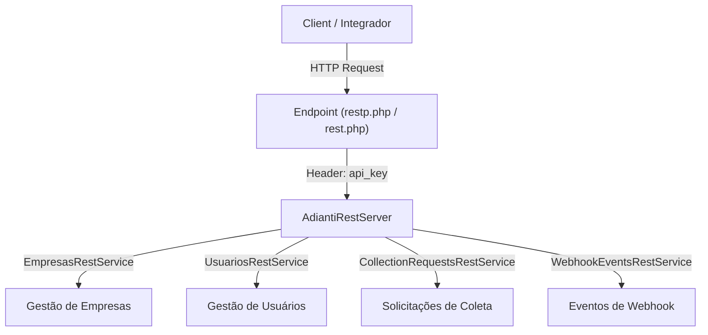

# 📚 Documentação da API REST - Captura de Documentos

Bem-vindo à documentação oficial da **API REST de Captura de Documentos**. Esta documentação foi elaborada para orientar desenvolvedores e integradores a consumir nossas rotas de maneira simples, rápida e segura.

---

## 🗺️ Visão Geral da Arquitetura

A API é construída sobre o framework Adianti e fornece serviços para gestão de empresas parceiras, cadastro de usuários, criação e acompanhamento de solicitações de coleta de documentos, além da consulta de eventos de Webhook.



---

## 🚀 Endpoints Base & Estrutura de Chamadas

A API utiliza a estrutura de roteamento do Adianti Framework baseada nos parâmetros de URL `class` e `method`.

- **URL Base Pública (Recomendada)**:
  `https://seu-dominio.com.br/restp.php`
- **URL Base Autenticada (Interna)**:
  `https://seu-dominio.com.br/rest.php`

### Parâmetros da Requisição

Toda requisição deve especificar a classe e o método manipulador:

| Parâmetro | Tipo | Descrição | Exemplo |
| :--- | :--- | :--- | :--- |
| `class` | `string` | Nome da classe REST Service a ser executada | `EmpresasRestService` |
| `method` | `string` | Método de entrada da classe | `handle` |

> [!NOTE]
> O método `handle` identifica automaticamente o verbo HTTP da requisição (`GET`, `POST`, `PUT`, `DELETE`) e direciona o fluxo para a ação apropriada.

---

## 🔑 Autenticação

A maioria dos serviços exige autenticação via **API Key** enviada no **Header HTTP** da requisição.

### Cabeçalho Obrigatório

```http
api_key: SUA_CHAVE_API_AQUI
Content-Type: application/json
```

> [!IMPORTANT]
> A `api_key` é gerada no momento do cadastro da empresa (via `POST` em `EmpresasRestService`). Guarde sua chave com segurança em variáveis de ambiente, pois ela permite identificar e isolar os dados da sua empresa.

---

## 📦 Formato das Respota (JSON)

Todas as respostas são retornadas em formato `application/json; charset=utf-8`.

### Resposta de Sucesso Padrão

```json
{
  "status": "success",
  "data": {
    "message": "Operação realizada com sucesso",
    "result": { ... }
  }
}
```

### Resposta de Erro Padrão

```json
{
  "status": "error",
  "data": "Descrição detalhada do erro ocorrido"
}
```

---

## 📊 Códigos de Status HTTP

| Código | Descrição | Significado na API |
| :--- | :--- | :--- |
| `200 OK` | Sucesso | A requisição foi processada e os dados retornados com sucesso. |
| `201 Created` | Criado | Um recurso (Empresa, Usuário ou Coleta) foi criado com sucesso. |
| `400 Bad Request` | Requisição Inválida | Parâmetros obrigatórios ausentes ou validação falhou (ex: CPF duplicado). |
| `401 Unauthorized` | Não Autorizado | Falha de autenticação geral no servidor REST. |
| `403 Forbidden` | Proibido | `api_key` inválida ou não fornecida. |
| `404 Not Found` | Não Encontrado | O recurso solicitado (ID ou Webhook) não foi encontrado. |
| `500 Internal Error` | Erro Interno | Erro inesperado ao processar a solicitação no servidor. |

---

## 📁 Serviços Disponíveis

Acesse a documentação detalhada de cada serviço individual nos links abaixo:

1. 🏢 **[EmpresasRestService](file:///Users/edutronicos/Projetos/capturaDocumentos/Documentacao/Empresas.md)**
   Cadastro de empresas, obtenção da `api_key` e atualização de cadastro/webhook.
2. 👤 **[UsuariosRestService](file:///Users/edutronicos/Projetos/capturaDocumentos/Documentacao/Usuarios.md)**
   Criação de usuários atrelados à empresa e geração automatizada de solicitação de coleta.
3. 📋 **[CollectionRequestsRestService](file:///Users/edutronicos/Projetos/capturaDocumentos/Documentacao/CollectionRequests.md)**
   Gestão manual de solicitações de coleta e tokens de validação temporários (24h).
4. 🔔 **[WebhookEventsRestService](file:///Users/edutronicos/Projetos/capturaDocumentos/Documentacao/WebhookEvents.md)**
   Consulta e histórico de eventos disparados via webhook para a empresa.
